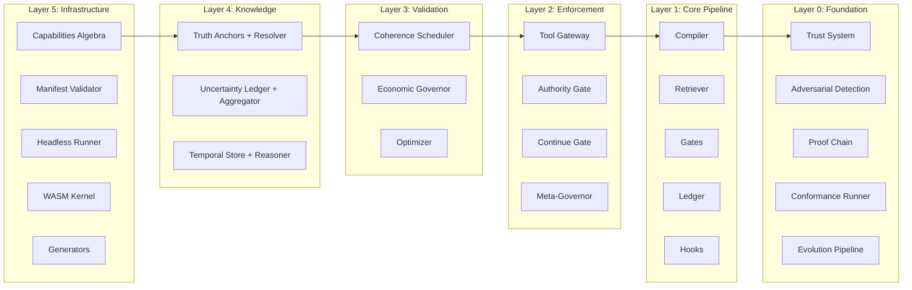
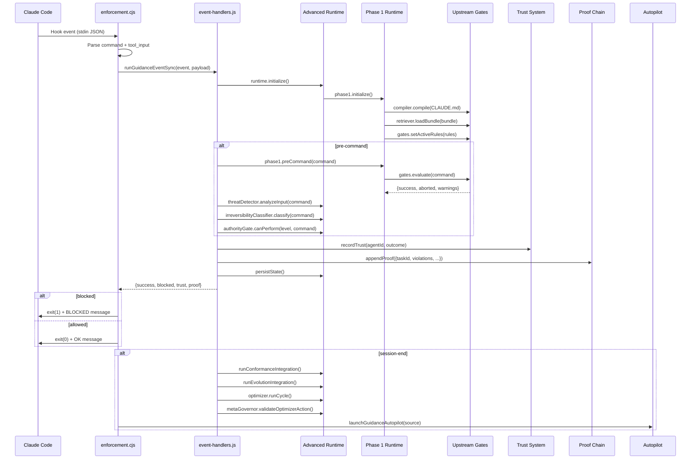
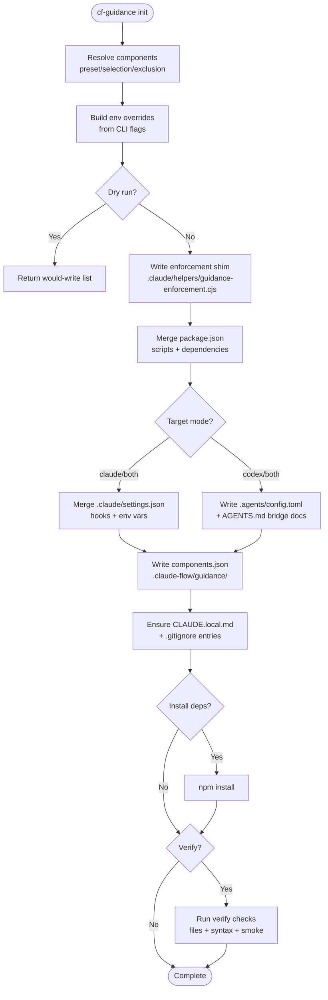
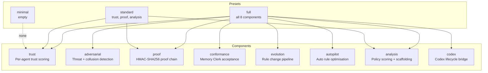
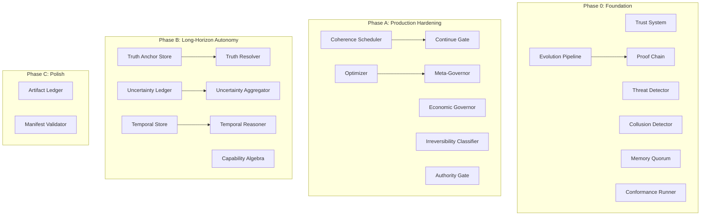
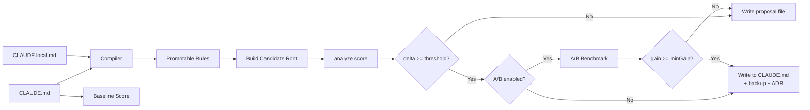

# Architecture

## System Overview

This package is a **wrapper implementation** that bridges the upstream `@claude-flow/guidance` control plane into real Claude Code and Codex environments. It does not duplicate the upstream logic — it instantiates, configures, and wires the upstream modules through a layered runtime with null-object fallbacks for disabled components.

```mermaid
graph TB
    subgraph "User Environment"
        CC[Claude Code Session]
        CX[OpenAI Codex]
        CMD[CLAUDE.md + CLAUDE.local.md]
    end

    subgraph "This Package: @sparkleideas/claude-flow-guidance"
        INS[Installer<br/>installer.mjs]
        ENF[Enforcement Handler<br/>enforcement.cjs]
        P1[Phase 1 Runtime<br/>phase1-runtime.js]
        ADV[Advanced Runtime<br/>advanced-runtime.js]
        MWG[Memory Write Gate<br/>memory-write-gate.js]
        EP[Embedding Provider<br/>embedding-provider.js]
        EH[Event Handlers<br/>event-handlers.js]
        AP[Autopilot<br/>guidance-autopilot.js]
    end

    subgraph "Upstream: @claude-flow/guidance"
        COMP[Compiler]
        RET[Retriever]
        GT[Gates]
        TR[Trust System]
        ADV_U[Adversarial Detection]
        PR[Proof Chain]
        EV[Evolution Pipeline]
        COH[Coherence Scheduler]
        AUTH[Authority Gate]
        MG[Meta-Governance]
        OPT[Optimizer]
        TA[Truth Anchors]
        UNC[Uncertainty Ledger]
        TMP[Temporal Store]
        CAP[Capabilities Algebra]
        ART[Artifact Ledger]
        MAN[Manifest Validator]
        PER[Persistent Ledger]
        GW[Tool Gateway]
        CG[Continue Gate]
    end

    subgraph "Upstream: @claude-flow/hooks"
        HR[HookRegistry]
        HE[HookExecutor]
        HEV[HookEvent]
    end

    CC -->|hooks| ENF
    CX -->|bridge| ENF
    INS -->|wires| CC
    INS -->|wires| CX
    ENF -->|dispatches| EH
    EH -->|initialises| ADV
    ADV -->|creates| P1
    P1 -->|uses| COMP
    P1 -->|uses| RET
    P1 -->|uses| GT
    P1 -->|uses| HR
    P1 -->|uses| HE
    P1 -->|uses| PER
    P1 -->|uses| GW
    ADV -->|uses| TR
    ADV -->|uses| ADV_U
    ADV -->|uses| PR
    ADV -->|uses| EV
    ADV -->|uses| COH
    ADV -->|uses| AUTH
    ADV -->|uses| MG
    ADV -->|uses| OPT
    ADV -->|uses| TA
    ADV -->|uses| UNC
    ADV -->|uses| TMP
    ADV -->|uses| CAP
    ADV -->|uses| ART
    ADV -->|uses| MAN
    ADV -->|uses| CG
    MWG -->|wraps| EP
    MWG -->|cosine similarity| EP
    AP -->|analyses| CMD
    AP -->|benchmarks| COMP
```

## Layered Architecture

The implementation follows a layered architecture where each layer wraps a set of upstream modules with null-object fallbacks:

Each layer has a corresponding `*-layer.js` file that provides null-object factories:

| Layer | File | Null Factories |
|---|---|---|
| Enforcement | `enforcement-layer.js` | Gateway, Authority, Continue Gate, Meta-Governor |
| Observation | `observation-layer.js` | Persistent Ledger, Artifact Ledger |
| Validation | `validation-layer.js` | Coherence Scheduler, Economic Governor, Optimizer |
| Knowledge | `knowledge-layer.js` | Truth Anchors/Resolver, Uncertainty Ledger/Aggregator, Temporal Store/Reasoner |
| Infrastructure | `infrastructure-layer.js` | Capability Algebra, Manifest Validator, Headless, WASM, Generators |

## Hook Event Flow

When Claude Code fires a hook event, this is the processing pipeline:

## Installer Flow

The installer wires guidance into both Claude Code and Codex environments:

## Component System

Components can be toggled via presets or individual selection:

## Runtime Subsystem Graph

The Advanced Runtime instantiates 23+ subsystems. Components.json controls which are real vs null-object:

## Data Flow: Autopilot Loop

