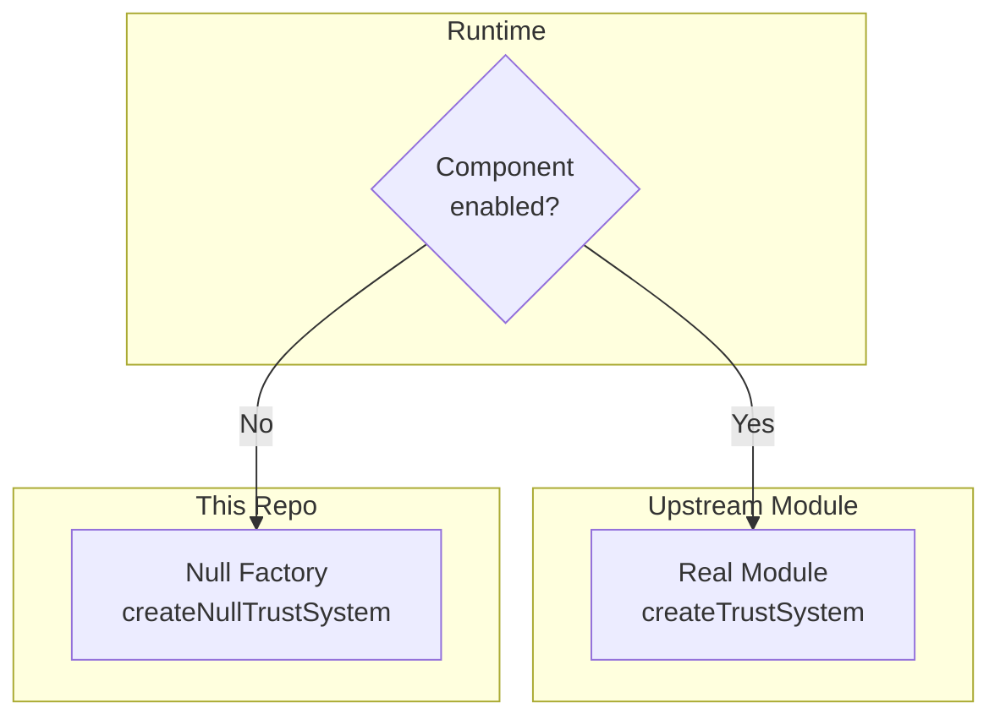

# Implementation Mapping

How this repository maps to the upstream `@claude-flow/guidance` package.

## Design Philosophy

This package does **not** re-implement the upstream guidance modules. Instead, it:

1. **Instantiates** upstream modules through a two-tier runtime
2. **Wraps** upstream APIs with convenience methods for Claude Code/Codex integration
3. **Provides null-object fallbacks** for every upstream module (component toggling)
4. **Adds two original modules**: embedding provider and memory write gate with semantic analysis
5. **Wires everything** into Claude Code hooks and Codex lifecycle events

## Module Mapping

```mermaid
graph LR
    subgraph "Upstream (32 modules)"
        U1[compiler]
        U2[retriever]
        U3[gates]
        U4[hooks]
        U5[ledger]
        U6[trust]
        U7[adversarial]
        U8[proof]
        U9[conformance-kit]
        U10[evolution]
        U11[coherence]
        U12[continue-gate]
        U13[gateway]
        U14[authority]
        U15[meta-governance]
        U16[optimizer]
        U17[persistence]
        U18[truth-anchors]
        U19[uncertainty]
        U20[temporal]
        U21[capabilities]
        U22[artifacts]
        U23[manifest-validator]
        U24[headless]
        U25[wasm-kernel]
        U26[generators]
        U27[analyzer]
        U28[memory-gate]
        U29[types]
        U30[index]
        U31[crypto-utils]
        U32[ruvbot-integration]
    end

    subgraph "This Repo (14 source files)"
        L1[phase1-runtime.js]
        L2[advanced-runtime.js]
        L3[enforcement-layer.js]
        L4[observation-layer.js]
        L5[validation-layer.js]
        L6[knowledge-layer.js]
        L7[infrastructure-layer.js]
        L8[embedding-provider.js]
        L9[memory-write-gate.js]
        L10[integration-runners.js]
        L11[content-aware-executor.js]
        L12[installer.mjs]
        L13[default-settings.mjs]
        L14[enforcement.cjs]
    end

    U1 --> L1
    U2 --> L1
    U3 --> L1
    U4 --> L1
    U5 --> L1
    U17 --> L1
    U13 --> L1

    U6 --> L2
    U7 --> L2
    U8 --> L2
    U9 --> L2
    U10 --> L2
    U11 --> L2
    U12 --> L2
    U14 --> L2
    U15 --> L2
    U16 --> L2
    U18 --> L2
    U19 --> L2
    U20 --> L2
    U21 --> L2
    U22 --> L2
    U23 --> L2

    U13 --> L3
    U14 --> L3
    U12 --> L3
    U15 --> L3

    U5 --> L4
    U22 --> L4

    U11 --> L5
    U16 --> L5

    U18 --> L6
    U19 --> L6
    U20 --> L6

    U21 --> L7
    U23 --> L7
    U24 --> L7
    U25 --> L7
    U26 --> L7

    U28 --> L9

    U27 --> L11
```

## Detailed Mapping Table

| Upstream Module | Used By | How |
|---|---|---|
| `compiler` | `phase1-runtime.js` | `createCompiler()` — compiles CLAUDE.md |
| `retriever` | `phase1-runtime.js` | `createRetriever()` — intent-based rule lookup |
| `gates` | `phase1-runtime.js` | `createGates()` — rule enforcement |
| `hooks` | `phase1-runtime.js` | `createGuidanceHooks()` — registers hooks |
| `ledger` | `phase1-runtime.js`, `observation-layer.js` | `createLedger()` — in-memory event store |
| `persistence` | `phase1-runtime.js` | `createPersistentLedger()` — NDJSON event store |
| `gateway` | `phase1-runtime.js` | `createToolGateway()` — idempotent gate wrapper |
| `trust` | `advanced-runtime.js` | `createTrustSystem()` — per-agent scoring |
| `adversarial` | `advanced-runtime.js` | `createThreatDetector()`, `createCollusionDetector()`, `createMemoryQuorum()` |
| `proof` | `advanced-runtime.js`, `integration-runners.js` | `createProofChain()` — HMAC hash chain |
| `conformance-kit` | `advanced-runtime.js` | `createConformanceRunner()` — acceptance tests |
| `evolution` | `advanced-runtime.js` | `createEvolutionPipeline()` — rule changes |
| `coherence` | `advanced-runtime.js` | `createCoherenceScheduler()`, `createEconomicGovernor()` |
| `continue-gate` | `advanced-runtime.js` | `createContinueGate()` — loop prevention |
| `authority` | `advanced-runtime.js` | `createAuthorityGate()`, `createIrreversibilityClassifier()` |
| `meta-governance` | `advanced-runtime.js` | `createMetaGovernor()` — constitutional invariants |
| `optimizer` | `advanced-runtime.js` | `createOptimizer()` — violation-driven evolution |
| `truth-anchors` | `advanced-runtime.js` | `createTruthAnchorStore()`, `createTruthResolver()` |
| `uncertainty` | `advanced-runtime.js` | `createUncertaintyLedger()`, `createUncertaintyAggregator()` |
| `temporal` | `advanced-runtime.js` | `createTemporalStore()`, `createTemporalReasoner()` |
| `capabilities` | `advanced-runtime.js` | `createCapabilityAlgebra()` — per-agent tokens |
| `artifacts` | `advanced-runtime.js` | `createArtifactLedger()` — signed records |
| `manifest-validator` | `advanced-runtime.js` | `createManifestValidator()` — admission control |
| `memory-gate` | `memory-write-gate.js` | `createMemoryWriteGate()`, `createMemoryEntry()` |
| `analyzer` | `guidance-autopilot.js`, `guidance-ab-benchmark.js` | `analyze()`, `benchmark()`, `abBenchmark()` |
| `headless` | `infrastructure-layer.js` (null only) | Not instantiated — null fallback only |
| `wasm-kernel` | `infrastructure-layer.js` (null only) | Not instantiated — Node.js crypto fallback |
| `generators` | `infrastructure-layer.js` (null only) | Not instantiated — stub generation |
| `ruvbot-integration` | Not used | External integration point |
| `types` | Implicit | Type definitions consumed via TypeScript |
| `crypto-utils` | Implicit | Used internally by proof and signing |
| `index` | Not used | Barrel export |

## Original Modules (Not in Upstream)

These modules are unique to this implementation:

| Module | Purpose |
|---|---|
| `embedding-provider.js` | `IEmbeddingProvider` interface with hash and AgentDB implementations |
| `memory-write-gate.js` | Wraps upstream `memory-gate` with semantic contradiction detection via cosine similarity |
| `content-aware-executor.js` | Synthetic executor for A/B benchmarking without external Claude process |
| `integration-runners.js` | 13 integration runners exercising every subsystem |
| `installer.mjs` | One-command repo wiring (Claude Code + Codex) |
| `default-settings.mjs` | Central configuration hub with 8 component definitions, 3 presets, AgentDB config builder |
| `enforcement.cjs` | Claude Code hook handler with command dispatch table |
| `event-handlers.js` | Full event handler implementing the guidance pipeline per hook event |
| `guidance-autopilot.js` | Autopilot loop for rule promotion with A/B benchmarking |

## Null-Object Coverage

Every upstream module has a corresponding null-object factory, ensuring the runtime works correctly even when components are disabled:

| Upstream Factory | Null Factory | File |
|---|---|---|
| `createTrustSystem` | `createNullTrustSystem` | `advanced-runtime.js` |
| `createThreatDetector` | `createNullThreatDetector` | `advanced-runtime.js` |
| `createCollusionDetector` | `createNullCollusionDetector` | `advanced-runtime.js` |
| `createMemoryQuorum` | `createNullMemoryQuorum` | `advanced-runtime.js` |
| `createProofChain` | `createNullProofChain` | `advanced-runtime.js` |
| `createConformanceRunner` | `createNullConformanceRunner` | `advanced-runtime.js` |
| `createEvolutionPipeline` | `createNullEvolutionPipeline` | `advanced-runtime.js` |
| `createToolGateway` | `createNullToolGateway` | `enforcement-layer.js` |
| `createAuthorityGate` | `createNullAuthorityGate` | `enforcement-layer.js` |
| `createIrreversibilityClassifier` | `createNullIrreversibilityClassifier` | `enforcement-layer.js` |
| `createContinueGate` | `createNullContinueGate` | `enforcement-layer.js` |
| `createMetaGovernor` | `createNullMetaGovernor` | `enforcement-layer.js` |
| `createPersistentLedger` | `createNullPersistentLedger` | `observation-layer.js` |
| `createArtifactLedger` | `createNullArtifactLedger` | `observation-layer.js` |
| `createCoherenceScheduler` | `createNullCoherenceScheduler` | `validation-layer.js` |
| `createEconomicGovernor` | `createNullEconomicGovernor` | `validation-layer.js` |
| `createOptimizer` | `createNullOptimizer` | `validation-layer.js` |
| `createTruthAnchorStore` | `createNullTruthAnchorStore` | `knowledge-layer.js` |
| `createTruthResolver` | `createNullTruthResolver` | `knowledge-layer.js` |
| `createUncertaintyLedger` | `createNullUncertaintyLedger` | `knowledge-layer.js` |
| `createUncertaintyAggregator` | `createNullUncertaintyAggregator` | `knowledge-layer.js` |
| `createTemporalStore` | `createNullTemporalStore` | `knowledge-layer.js` |
| `createTemporalReasoner` | `createNullTemporalReasoner` | `knowledge-layer.js` |
| `createCapabilityAlgebra` | `createNullCapabilityAlgebra` | `infrastructure-layer.js` |
| `createManifestValidator` | `createNullManifestValidator` | `infrastructure-layer.js` |
| `createConformanceSuite` | `createNullConformanceSuite` | `infrastructure-layer.js` |
| `createHeadlessRunner` | `createNullHeadlessRunner` | `infrastructure-layer.js` |
| `createWasmKernel` | `createNullWasmKernel` | `infrastructure-layer.js` |
| `createGenerators` | `createNullGenerators` | `infrastructure-layer.js` |

## Version Alignment

| Package | Version |
|---|---|
| `@claude-flow/guidance` (upstream) | `3.0.0-alpha.1` |
| `@claude-flow/hooks` (upstream) | `^3.0.0-alpha.7` |
| `@sparkleideas/claude-flow-guidance` (this repo) | `3.0.0-alpha.1.wrapper.6` |

The wrapper version (`wrapper.6`) tracks implementation iterations independently from the upstream alpha releases.
