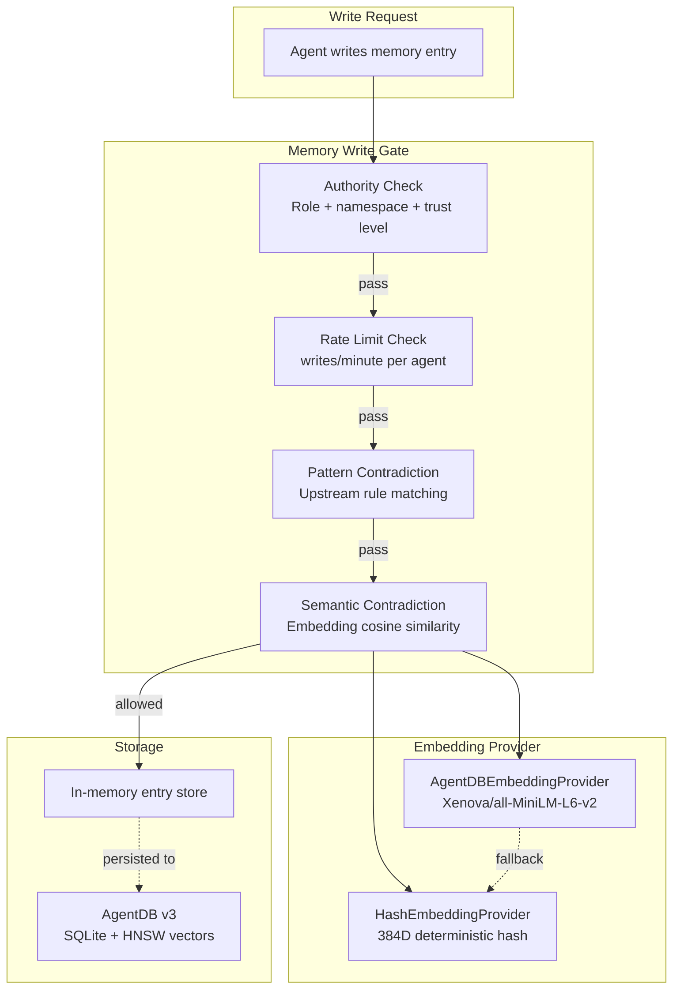
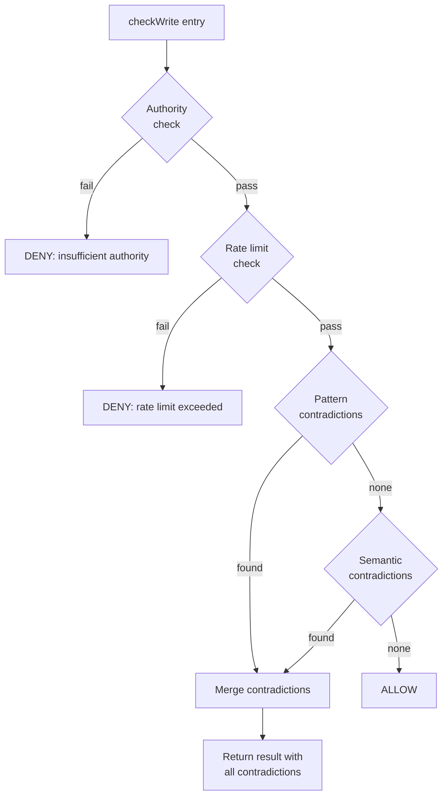
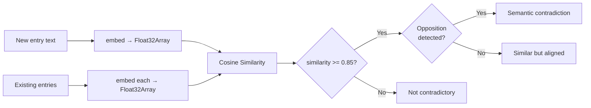
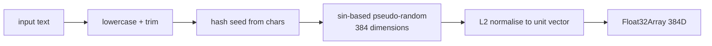
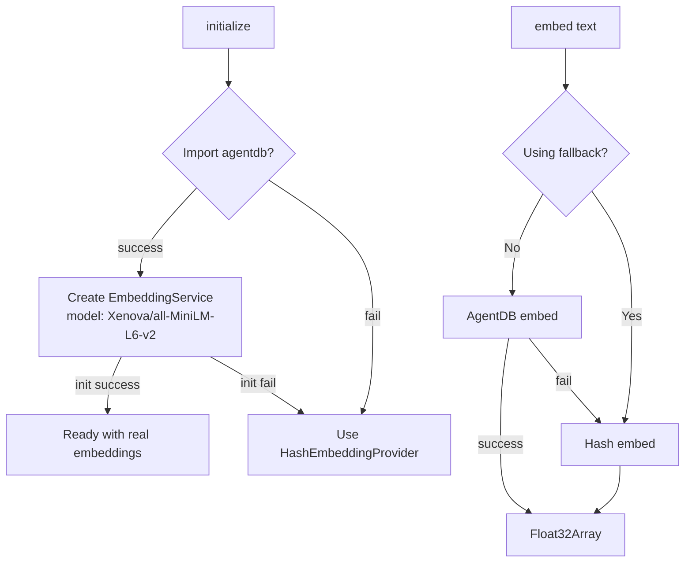
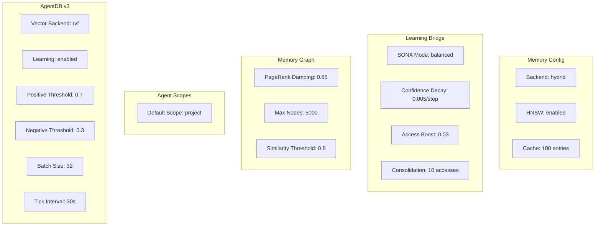
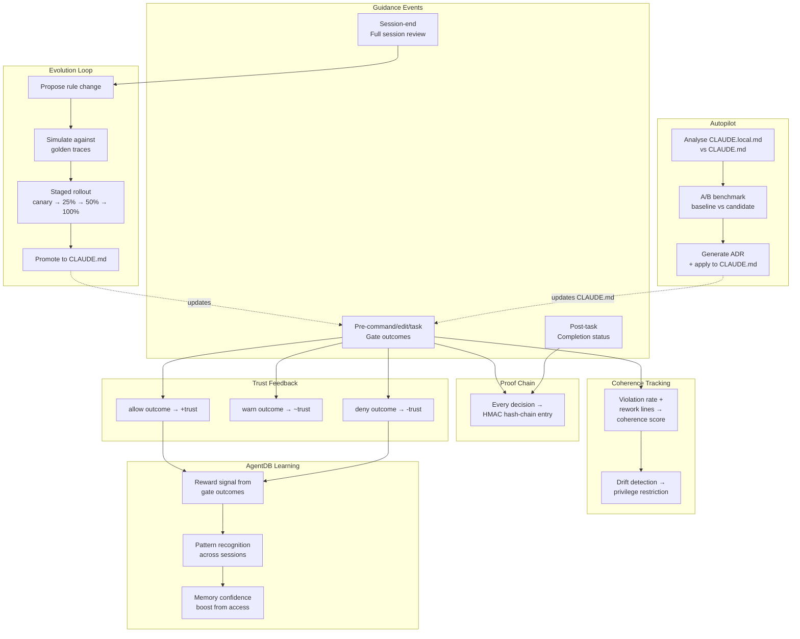
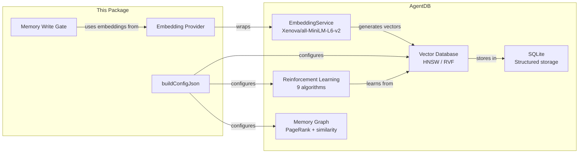

# Memory & Learning System

How the memory gate, embedding system, and learning pipeline are implemented for guidance functionality.

## Overview

The memory and learning system has three integrated layers:

1. **Memory Write Gate** — Pre-write policy enforcement with semantic contradiction detection
2. **Embedding Provider** — Text-to-vector embeddings for semantic similarity operations
3. **AgentDB v3 Integration** — Persistent vector storage, HNSW indexing, and reinforcement learning



## Memory Write Gate

The `MemoryWriteGateHook` class (`src/guidance/memory-write-gate.js`) wraps the upstream `@claude-flow/guidance/memory-gate` module with additional semantic analysis.

### Gate Pipeline



### Authority Model

Each agent is assigned an authority that controls what it can write:

```typescript
interface MemoryAuthority {
  agentId: string;           // Agent identifier
  role: string;              // worker | coordinator | admin
  namespaces: string[];      // Allowed namespaces
  maxWritesPerMinute: number; // Rate limit
  canDelete: boolean;        // Delete permission
  canOverwrite: boolean;     // Overwrite permission
  trustLevel: number;        // 0.0 to 1.0
}
```

**Default Authority** (unregistered agents):
```
role: worker
namespaces: [default]
maxWritesPerMinute: 60
canDelete: false
canOverwrite: false
trustLevel: 0.5
```

### Semantic Contradiction Detection

When an entry passes authority and rate-limit checks, the gate performs semantic analysis:

1. **Embed the new value** using the configured embedding provider
2. **Embed all existing entries** in the same namespace
3. **Compute cosine similarity** between the new embedding and each existing one
4. **If similarity >= threshold (0.85)**, check for opposition patterns



**Opposition Detection Patterns:**

The `_detectOpposition()` method checks for keyword pairs that indicate conflicting directives:

| Pattern A | Pattern B | Example |
|---|---|---|
| `always` | `never` | "always use tabs" vs "never use tabs" |
| `must` | `never`/`do not`/`don't` | "must validate" vs "don't validate" |
| `require` | `forbid`/`prohibit` | "require tests" vs "forbid tests" |
| `enable` | `disable` | "enable logging" vs "disable logging" |
| `true` | `false` | "strict: true" vs "strict: false" |
| `use tabs` | `use spaces` | formatting conflicts |

## Embedding Provider

The `IEmbeddingProvider` interface (`src/guidance/embedding-provider.js`) abstracts text-to-vector embedding generation.

### HashEmbeddingProvider

A deterministic, zero-dependency provider for testing:



**Properties:**
- Dimension: 384 (configurable)
- Deterministic: same input always produces same output
- Zero dependencies
- Suitable for tests only (no semantic meaning)

### AgentDBEmbeddingProvider

Production provider that wraps AgentDB's EmbeddingService:



**Properties:**
- Model: `Xenova/all-MiniLM-L6-v2` (configurable)
- Dimension: 384 (configurable)
- Graceful fallback to hash provider on import/embed failure
- Batch embedding via `embedBatch()`

### Factory

```javascript
import { createEmbeddingProvider } from './embedding-provider.js';

// For tests
const hash = createEmbeddingProvider({ provider: 'hash' });

// For production
const agentdb = createEmbeddingProvider({ provider: 'agentdb' });
```

## AgentDB v3 Memory Configuration

The `buildConfigJson()` function in `default-settings.mjs` generates the full memory configuration:



### Configuration Parameters

| Parameter | Default | Description |
|---|---|---|
| `backend` | `hybrid` | Memory storage backend |
| `enableHNSW` | `true` | HNSW approximate nearest-neighbour indexing |
| `cacheSize` | `100` | In-memory cache entries |
| **Learning Bridge** | | |
| `learningBridge` | `true` | Enable learning integration |
| `sonaMode` | `balanced` | SONA learning mode |
| `confidenceDecayRate` | `0.005` | Per-step confidence decay |
| `accessBoostAmount` | `0.03` | Confidence boost per access |
| `consolidationThreshold` | `10` | Accesses before consolidation |
| **Memory Graph** | | |
| `memoryGraph` | `true` | Enable memory graph |
| `pageRankDamping` | `0.85` | PageRank damping factor |
| `maxNodes` | `5000` | Maximum graph nodes |
| `similarityThreshold` | `0.8` | Edge creation threshold |
| **Agent Scopes** | | |
| `agentScopes` | `true` | Enable per-agent scoping |
| `defaultScope` | `project` | Default memory scope |
| **AgentDB v3** | | |
| `agentdbVectorBackend` | `rvf` | Vector backend (rvf/hnswlib) |
| `agentdbEnableLearning` | `true` | Enable RL-based learning |
| `agentdbPositiveThreshold` | `0.7` | Positive reward threshold |
| `agentdbNegativeThreshold` | `0.3` | Negative reward threshold |
| `agentdbBatchSize` | `32` | Learning batch size |
| `agentdbTickInterval` | `30000` | Learning tick interval (ms) |

## Learning Pipeline

The learning system integrates with the guidance control plane through multiple feedback loops:



### Trust-Based Learning

The trust system learns from every guidance decision:

1. **Allow** → increase trust score → higher rate limits, more autonomy
2. **Warn** → slight trust decrease → warnings surface to agent
3. **Deny** → significant trust decrease → restrictions applied

Trust scores determine per-agent rate limits:
```
effectiveRateLimit = baseRateLimit * trustMultiplier(score)
```

### Optimizer Learning

The optimizer (`@claude-flow/guidance/optimizer`) uses a "win twice to promote" pattern:

1. Collect top violations from the ledger
2. Propose rule changes targeting those violations
3. Evaluate each change against a baseline
4. Track wins — a change must improve metrics in 2+ cycles
5. Promote winning changes with meta-governance approval

### Autopilot Learning

The autopilot script (`scripts/guidance-autopilot.js`) provides automated rule promotion:

1. Parse `CLAUDE.local.md` for experimental rules
2. Build a candidate `CLAUDE.md` with those rules promoted
3. Analyse composite scores (before vs after)
4. Optional: Run A/B benchmark with synthetic executor
5. If delta exceeds threshold and A/B gate passes → apply + write ADR

### Memory Confidence Decay

The SONA learning bridge implements confidence decay and access boosting:

- **Decay:** Each memory entry's confidence decreases by `confidenceDecayRate` (0.005) per step
- **Boost:** Each access increases confidence by `accessBoostAmount` (0.03)
- **Consolidation:** After `consolidationThreshold` (10) accesses, an entry is consolidated into long-term memory
- **PageRank:** Memory graph uses PageRank (damping=0.85) to identify high-value memory nodes

## Integration with Upstream AgentDB

AgentDB provides the storage and learning backend:



**Key AgentDB Features Used:**
- **HNSW indexing** for fast approximate nearest-neighbour search
- **RVF vector backend** for persistent vector storage
- **Reinforcement learning** with positive/negative thresholds
- **Memory graph** with PageRank for importance scoring
- **Agent scopes** for namespace isolation between agents
