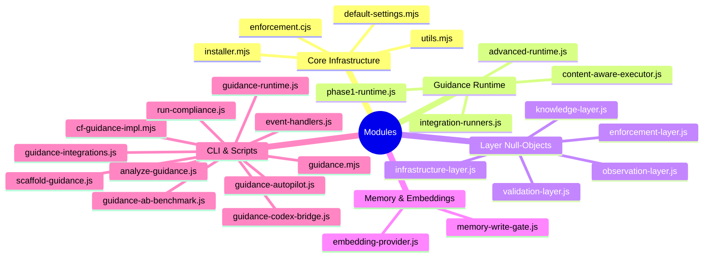

# Module Reference

Complete reference of all implemented modules, organised by category.

## Module Categories

---

## Category 1: Core Infrastructure

Modules responsible for installation, configuration, utilities, and the hook entry point.

### `src/installer.mjs`

**Purpose:** Installs and verifies guidance wiring in a target repository.

**Exports:**
- `installIntoRepo(options)` — Writes enforcement shim, merges package.json, hooks, env vars, Codex config
- `verifyRepo(options)` — Checks files exist, syntax validation, smoke test
- `initRepo(options)` — Combines install + verify in one call

**Key Features:**
- Supports three target modes: `claude`, `codex`, `both`
- Component-based installation with presets (minimal/standard/full)
- Dry-run mode for previewing changes
- Hook command deduplication with normalisation
- Persists component selection in `.claude-flow/guidance/components.json`
- Flag-driven env var overrides (fail-closed, autopilot, timeouts)

### `src/default-settings.mjs`

**Purpose:** Central configuration hub for all defaults, hook definitions, components, and presets.

**Exports:**
- `GUIDANCE_ENV_DEFAULTS` — 10 environment variable defaults
- `buildHookDefaults(timeout)` — Generates hook blocks for 8 Claude Code events
- `GUIDANCE_HOOKS_DEFAULTS` — Pre-built hook defaults (5000ms timeout)
- `GUIDANCE_PACKAGE_SCRIPTS` — 20 npm script definitions
- `GUIDANCE_PACKAGE_DEPS` — Package dependency map
- `GUIDANCE_COMPONENTS` — 8 component definitions (trust, adversarial, proof, conformance, evolution, autopilot, analysis, codex)
- `GUIDANCE_CORE_SCRIPTS` — 4 always-included scripts
- `GUIDANCE_PRESETS` — 3 presets (minimal, standard, full)
- `buildConfigJson(options)` — Builds AgentDB v3 memory config
- `resolveComponents(options)` — Resolves component list from preset/selection/exclusion

**Hook Events Covered:**
| Event | Matcher | Handler |
|---|---|---|
| PreToolUse | Write\|Edit\|MultiEdit | pre-edit |
| PreToolUse | Bash | pre-command |
| PreToolUse | Task | pre-task |
| PostToolUse | Write\|Edit\|MultiEdit | post-edit |
| PostToolUse | Task | post-task |
| PostToolUseFailure | (all) | post-tool-failure |
| UserPromptSubmit | (all) | user-prompt |
| SessionStart | (all) | session-restore |
| SessionEnd | (all) | session-end |
| Stop | (all) | stop |
| PreCompact | manual | compact-manual |
| PreCompact | auto | compact-auto |

### `src/utils.mjs`

**Purpose:** Shared utility functions used across the package.

**Exports:**
- `safeString(value, fallback)` — Safe string coercion
- `toPositiveInteger(value, fallback)` — Safe positive integer parsing
- `readJson(filePath, fallback)` — Safe JSON file reading
- `parseJson(value, fallback)` — Safe JSON string parsing
- `safeArray(input)` — Array coercion
- `ensureDir(path)` — Recursive directory creation
- `writeJson(filePath, value)` — JSON file writing with ensureDir
- `nowIso()` — Current ISO timestamp
- `outcomeFromHookResult(result)` — Converts hook result to allow/warn/deny
- `severityFromThreat(threat)` — Converts threat severity to high/medium/low

### `src/enforcement.cjs`

**Purpose:** Claude Code hook handler that runs alongside upstream hooks. CommonJS for Claude Code compatibility.

**Command Dispatch Table:**

| Command | Behaviour |
|---|---|
| `pre-command` | Sync gate check + dangerous pattern detection → blocks or allows |
| `pre-edit` | Sync gate check for file edits → blocks or allows |
| `pre-task` | Sync gate check + task context caching → blocks or allows |
| `post-edit` | Async event fire (non-blocking) |
| `post-task` | Async event fire with remembered task context |
| `session-end` | Async event fire + launch autopilot |
| `compact-manual` | Print guidance context for manual compaction |
| `compact-auto` | Print guidance context for auto compaction |
| `user-prompt` | Acknowledge |
| `post-tool-failure` | Acknowledge |
| `stop` | Acknowledge |
| `session-restore` | Acknowledge |

---

## Category 2: Guidance Runtime

The two-tier runtime that instantiates upstream modules.

### `src/guidance/phase1-runtime.js`

**Purpose:** Core compile → retrieve → gate → hook pipeline. The foundation for all guidance enforcement.

**Class:** `GuidancePhase1Runtime`

**Lifecycle:**
1. `initialize()` — Reads CLAUDE.md, compiles bundle, loads retriever, sets gate rules, registers hooks
2. `preTask(options)` / `postTask(options)` — Task lifecycle enforcement
3. `preCommand(command)` — Command validation through gateway + gates
4. `preToolUse(toolName, params)` — Generic tool validation through gateway + gates
5. `preEdit(options)` — File edit validation
6. `getStatus()` — Returns runtime metrics
7. `destroy()` — Saves and cleans up persistent ledger

**Upstream Modules Used:**
- `createCompiler()` — from `@claude-flow/guidance/compiler`
- `createRetriever()` — from `@claude-flow/guidance/retriever`
- `createGates()` — from `@claude-flow/guidance/gates`
- `createGuidanceHooks()` — from `@claude-flow/guidance/hooks`
- `createPersistentLedger()` — from `@claude-flow/guidance/persistence`
- `createToolGateway()` — from `@claude-flow/guidance/gateway`
- `HookEvent`, `HookExecutor`, `HookRegistry` — from `@claude-flow/hooks`

### `src/guidance/advanced-runtime.js`

**Purpose:** Full 23-subsystem runtime with component toggling via `components.json`.

**Class:** `GuidanceAdvancedRuntime`

**Subsystems (23):**
1. `phase1` — GuidancePhase1Runtime (nested)
2. `trustSystem` — Per-agent trust scoring
3. `threatDetector` — Prompt injection detection
4. `collusionDetector` — Agent collusion ring analysis
5. `memoryQuorum` — Quorum-based memory write voting
6. `proofChain` — HMAC hash-chained proof
7. `evolutionPipeline` — Rule change proposals
8. `conformanceRunner` — Acceptance testing
9. `coherenceScheduler` — Session degradation
10. `economicGovernor` — 5-resource budget tracking
11. `continueGate` — Loop/slope prevention
12. `irreversibilityClassifier` — Action classification
13. `authorityGate` — Escalation hierarchy
14. `metaGovernor` — Constitutional invariants
15. `optimizer` — Violation-driven rule promotion
16. `truthAnchorStore` — Ground truth attestations
17. `truthResolver` — Memory conflict resolution
18. `uncertaintyLedger` — Confidence intervals
19. `uncertaintyAggregator` — Multi-belief aggregation
20. `temporalStore` — Bitemporal assertions
21. `temporalReasoner` — Temporal querying
22. `capabilities` — Algebraic capability tokens
23. `artifactLedger` — Signed artifact records
24. `manifestValidator` — Agent admission control

**Integration Runners (13):**
The runtime binds 13 integration runner methods from `integration-runners.js`, each exercising a different subsystem with representative test data.

### `src/guidance/integration-runners.js`

**Purpose:** Integration test runners for each subsystem. Each runner initialises the runtime, exercises the subsystem with test data, records trust + proof, and persists state.

**Runners:**
| Runner | Tests |
|---|---|
| `runHooksIntegration` | Pre-task → pre-command (safe + dangerous) → post-task |
| `runTrustIntegration` | 5 outcome events → snapshot + rate limit check |
| `runAdversarialIntegration` | Injection + memory threats + collusion + quorum |
| `runProofIntegration` | Two proof appends → chain verification → export/import |
| `runConformanceIntegration` | Conformance test + replay verification |
| `runEvolutionIntegration` | Propose → simulate → compare → stage → advance |
| `runCoherenceIntegration` | Budget tracking + coherence score + privilege level |
| `runContinueGateIntegration` | 5-step evaluation with degrading inputs |
| `runAuthorityIntegration` | 5 action classifications + authority checks |
| `runMetaGovernanceIntegration` | Invariant checks + amendment proposal + optimizer validation |
| `runOptimizerIntegration` | Optimizer cycle on ledger data |
| `runKnowledgeIntegration` | Truth anchors + uncertainty beliefs + temporal assertions |
| `runCapabilitiesIntegration` | Grant + check(allowed) + check(denied) |

### `src/guidance/content-aware-executor.js`

**Purpose:** Lightweight in-process executor for A/B benchmarks. Produces behaviour differences between "no guidance" (weak baseline) and "with guidance" (policy-enriched) responses.

**Class:** `SyntheticContentAwareExecutor`

**Design:** Counts enforcement terms (`NEVER`, `ALWAYS`, `MUST`) in CLAUDE.md to determine guidance strength. Guided mode produces comprehensive implementation snippets; unguided mode produces minimal output.

---

## Category 3: Layer Null-Objects

Each layer provides null-object factories that match the upstream API signatures but return safe no-op defaults. Used when components are disabled.

### `src/guidance/enforcement-layer.js`

**Null Factories:**
- `createNullToolGateway()` — Always allows, no budget tracking
- `createNullAuthorityGate()` — Always allows, no escalation
- `createNullIrreversibilityClassifier()` — Always returns 'reversible'
- `createNullContinueGate()` — Always returns 'continue'
- `createNullMetaGovernor()` — All invariants pass, no amendments

### `src/guidance/observation-layer.js`

**Null Factories:**
- `createNullPersistentLedger()` — Wraps upstream in-memory ledger with no-op persistence methods
- `createNullArtifactLedger()` — No artifact recording

### `src/guidance/validation-layer.js`

**Null Factories:**
- `createNullCoherenceScheduler()` — Always healthy, score=1.0
- `createNullEconomicGovernor()` — Infinite budget
- `createNullOptimizer()` — Skips all cycles

### `src/guidance/knowledge-layer.js`

**Null Factories:**
- `createNullTruthAnchorStore()` — No anchors stored
- `createNullTruthResolver()` — Always resolves to internal
- `createNullUncertaintyLedger()` — Default confidence 0.7
- `createNullUncertaintyAggregator()` — Static aggregation
- `createNullTemporalStore()` — No assertions stored
- `createNullTemporalReasoner()` — Empty temporal queries

### `src/guidance/infrastructure-layer.js`

**Null Factories:**
- `createNullCapabilityAlgebra()` — Always allows, no tokens
- `createNullManifestValidator()` — Always valid, risk=0
- `createNullConformanceSuite()` — All tests pass
- `createNullHeadlessRunner()` — All tasks skipped/passed
- `createNullWasmKernel()` — Uses Node.js crypto fallback
- `createNullGenerators()` — Minimal stub generation

---

## Category 4: Memory & Embeddings

Modules implementing the memory gate and embedding provider for semantic operations.

### `src/guidance/embedding-provider.js`

**Purpose:** Defines `IEmbeddingProvider` interface and two implementations.

**Interface: `IEmbeddingProvider`**
- `initialize()` — One-time async init
- `embed(text)` → `Float32Array` — Single text to vector
- `batchEmbed(texts)` → `Float32Array[]` — Batch text to vectors
- `dimension()` → `number` — Embedding dimension
- `destroy()` — Cleanup

**Implementations:**

| Class | Dimension | Deps | Use Case |
|---|---|---|---|
| `HashEmbeddingProvider` | 384 | None | Deterministic, test-friendly |
| `AgentDBEmbeddingProvider` | 384 | AgentDB (optional) | Production with real embeddings |

**Factory:** `createEmbeddingProvider({ provider: 'hash' | 'agentdb' })`

### `src/guidance/memory-write-gate.js`

**Purpose:** Memory write gate with semantic contradiction detection.

**Class:** `MemoryWriteGateHook`

**Pipeline:**
1. **Authority check** — Via upstream `MemoryWriteGate.evaluateWrite()`
2. **Rate limit check** — Per-agent writes/minute enforcement
3. **Pattern contradiction** — Upstream rule-based pattern matching
4. **Semantic contradiction** — Embedding-based cosine similarity + opposition detection

**Opposition Detection Patterns:**
| Pattern A | Pattern B |
|---|---|
| `always` | `never` |
| `must` | `never` / `do not` / `don't` |
| `require` | `forbid` / `prohibit` |
| `enable` | `disable` |
| `true` | `false` |
| `use tabs` | `use spaces` |

---

## Category 5: CLI & Scripts

### `bin/guidance.mjs`

**Purpose:** Main CLI entry point. Dispatches to sub-command scripts.

**Commands:** init, install, verify, run, runtime, autopilot, benchmark, codex, analyze, scaffold

### `scripts/event-handlers.js`

**Purpose:** Full event handler dispatch. Called by `enforcement.cjs` via `runGuidanceEventSync()`.

**Events Handled:**
| Event | Subsystems Exercised |
|---|---|
| `pre-command` | Phase1 gates, threat detector, irreversibility classifier, authority gate, trust, proof |
| `pre-edit` | Phase1 gates, trust, proof |
| `pre-task` | Continue gate, Phase1 gates, trust, proof |
| `post-task` | Phase1 post-task, trust, proof |
| `post-edit` | Trust, proof |
| `session-end` | Conformance, evolution, optimizer, meta-governance |

### `scripts/guidance-autopilot.js`

**Purpose:** Autopilot loop for automatic rule promotion from `CLAUDE.local.md` to `CLAUDE.md`.

**Modes:** `--once` (single cycle), `--daemon` (repeated at interval)

**Pipeline:** Load guidance files → find promotable local rules → build candidate → analyse + benchmark → apply if threshold met → write backup + ADR

### `scripts/guidance-ab-benchmark.js`

**Purpose:** A/B comparison benchmarking between baseline and guided policy bundles.

### `scripts/analyze-guidance.js`

**Purpose:** Compile and score a CLAUDE.md policy bundle, producing composite quality metrics.

### `scripts/scaffold-guidance.js`

**Purpose:** Scaffold guidance file templates into a new project.

### `scripts/guidance-codex-bridge.js`

**Purpose:** OpenAI Codex lifecycle bridge. Dispatches guidance events through the Codex environment.

### `scripts/guidance-integrations.js`

**Purpose:** CLI runner for all integration test suites.

### `scripts/guidance-runtime.js`

**Purpose:** Runtime demo showing Phase1 and Advanced runtime capabilities.

### `scripts/run-compliance.js`

**Purpose:** Compliance check runner with optional JSON output.

---

## Test Coverage (33 files)

| Category | Test Files |
|---|---|
| **Core** | `installer.test.mjs`, `installer-helpers.test.mjs`, `default-settings.test.mjs`, `utils.test.mjs`, `utils-cjs.test.mjs`, `components.test.mjs` |
| **Enforcement** | `enforcement.test.mjs`, `enforcement-internals.test.mjs` |
| **Runtime** | `phase1-runtime.test.mjs`, `advanced-runtime-full.test.mjs`, `upstream-modules.test.mjs`, `integration-runners.test.mjs` |
| **Null Objects** | `null-objects-enforcement.test.mjs`, `null-objects-observation.test.mjs`, `null-objects-validation.test.mjs`, `null-objects-knowledge.test.mjs`, `null-objects-infrastructure.test.mjs` |
| **Memory** | `embedding-provider.test.mjs`, `memory-write-gate.test.mjs`, `memory-namespace.test.mjs`, `memory-concurrent.test.mjs`, `memory-error-handling.test.mjs`, `memory-lifecycle.test.mjs`, `memory-backend.test.mjs`, `memory-config.test.mjs` |
| **Features** | `autopilot.test.mjs`, `codex-bridge.test.mjs`, `content-aware-executor.test.mjs`, `event-handlers.test.mjs` |
| **E2E** | `e2e-behavioral-integration.test.mjs`, `e2e-init-install.test.mjs`, `e2e-full-pipeline.test.mjs`, `e2e-memory-agentdb-v3.test.mjs` |
