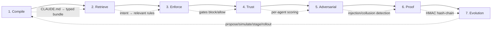
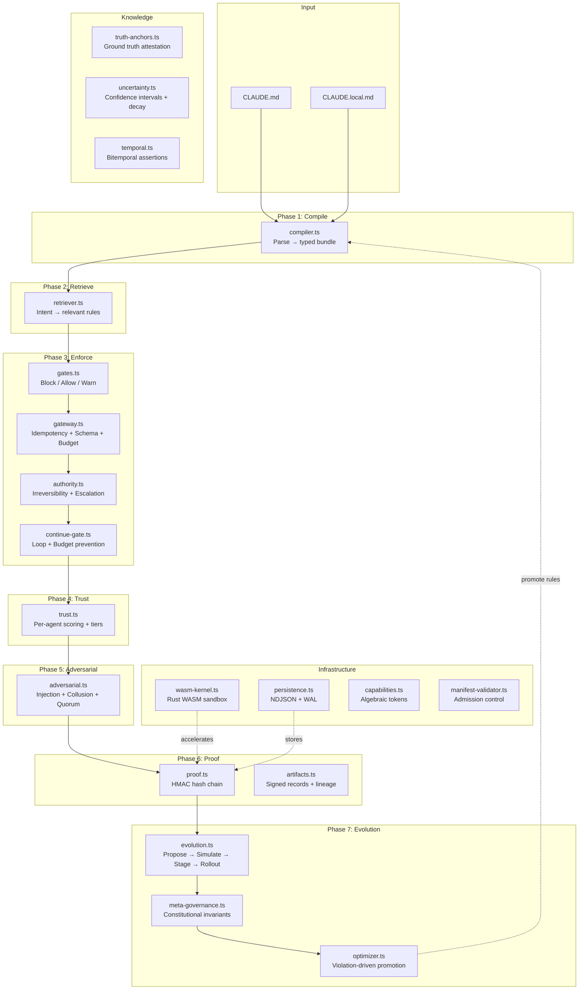
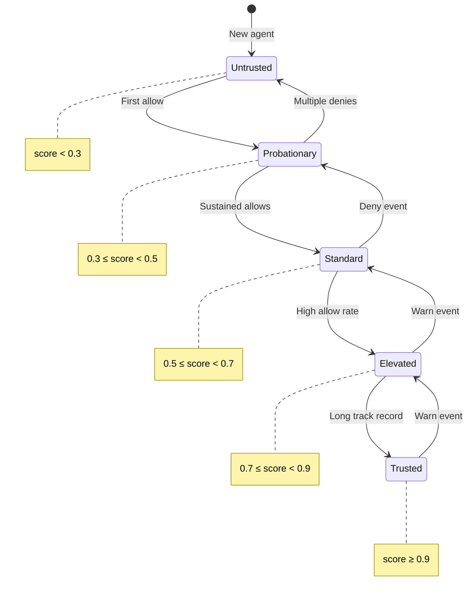

# Upstream `@claude-flow/guidance` Architecture

> Analysis of the upstream guidance control plane at `v3/@claude-flow/guidance` in the [claude-flow](https://github.com/ruvnet/claude-flow) repository.

## Package Overview

**Name:** `@claude-flow/guidance`
**Version:** 3.0.0-alpha.1
**Purpose:** Long-horizon governance for Claude Code agents. Transforms plain-text `CLAUDE.md` and `CLAUDE.local.md` files into enforceable policy through compilation, retrieval, enforcement, trust management, adversarial defence, cryptographic proofs, and automatic rule evolution.

**Problem Statement:** Agents that work well for short tasks degrade over extended sessions, forgetting rules, repeating mistakes, and corrupting their own memory. This package ensures agents operate autonomously for days rather than minutes while maintaining consistent rule compliance.

## Dependencies

| Package | Role |
|---|---|
| `@claude-flow/hooks` ^3.0.0-alpha.7 | Hook registry and event executor |
| `@claude-flow/memory` ^3.0.0-alpha.2 | Memory management backend |
| `@claude-flow/shared` ^3.0.0-alpha.1 | Shared types and utilities |

## 7-Phase Pipeline



## Source Modules (32 files)

### Core Pipeline

| Module | Purpose |
|---|---|
| `compiler.ts` | Parses CLAUDE.md + CLAUDE.local.md into typed policy bundles (constitution + task-scoped shards) |
| `retriever.ts` | Intent classification to retrieve relevant rules for a given task |
| `gates.ts` | Rule enforcement gates that block or allow tool/command usage |
| `hooks.ts` | Registers guidance hooks with the HookRegistry for lifecycle events |
| `ledger.ts` | In-memory run event ledger for tracking decisions |
| `types.ts` | TypeScript type definitions for all guidance interfaces |
| `index.ts` | Barrel export of all 27 named modules |

### Trust & Security

| Module | Purpose |
|---|---|
| `trust.ts` | Per-agent trust scoring with privilege tiers (allow/warn/deny outcome tracking) |
| `adversarial.ts` | Prompt injection detection, collusion detection ring analysis, memory quorum voting |
| `proof.ts` | HMAC-SHA256 hash-chained cryptographic proof chain for every decision |
| `authority.ts` | Irreversibility classification + authority-level escalation hierarchy |
| `truth-anchors.ts` | Ground truth attestations with HMAC signatures for multi-agent conflict resolution |
| `crypto-utils.ts` | Cryptographic utility functions (SHA-256, HMAC, content hashing) |

### Governance & Evolution

| Module | Purpose |
|---|---|
| `evolution.ts` | Propose, simulate, stage, and rollout rule changes with golden trace evaluation |
| `meta-governance.ts` | Constitutional invariants + supermajority amendment process |
| `optimizer.ts` | Violation-driven rule evolution — "win twice to promote" pattern |
| `conformance-kit.ts` | Memory Clerk acceptance testing with deterministic replay verification |

### Session Health

| Module | Purpose |
|---|---|
| `coherence.ts` | Session degradation detection (coherence scoring, drift detection) |
| `continue-gate.ts` | Budget slope detection + infinite loop prevention gate |
| `temporal.ts` | Bitemporal assertion store (what was true, what is true, what will be true) |
| `uncertainty.ts` | Formal confidence intervals with time decay and propagation |

### Integration & Infrastructure

| Module | Purpose |
|---|---|
| `gateway.ts` | Wraps gates with idempotency, schema validation, and budget metering |
| `persistence.ts` | NDJSON event store with compaction and WAL for persistent ledger |
| `capabilities.ts` | Algebraic capability tokens for per-agent permission management |
| `artifacts.ts` | Signed artifact records + lineage tracking |
| `manifest-validator.ts` | Agent admission control + risk scoring for manifests |
| `headless.ts` | CI/CD compliance test suite (headless runner) |
| `generators.ts` | CLAUDE.md scaffolding (stateless utility) |
| `analyzer.ts` | Policy analysis, scoring, benchmarking (composite score, A/B deltas) |
| `wasm-kernel.ts` | Rust-compiled WebAssembly kernel for security-critical operations |
| `ruvbot-integration.ts` | Integration with RuvBot automation system |

## Architecture Diagram



## WASM Kernel

Security-critical operations execute in a sandboxed Rust-compiled WebAssembly kernel (`wasm-kernel/`), with automatic fallback to JavaScript implementations. Operations include:

- SHA-256 hashing
- HMAC-SHA256 signing/verification
- Content hashing for proof chain
- Secret scanning in content
- Destructive command detection
- Batch processing of cryptographic operations

## 27 Named Exports

The package exports every module individually for granular consumption:

```
compiler, retriever, gates, hooks, ledger, optimizer,
headless, persistence, gateway, manifest-validator, proof,
memory-gate, coherence, artifacts, capabilities, evolution,
conformance-kit, ruvbot-integration,
trust, truth-anchors, uncertainty, temporal, authority, adversarial,
meta-governance, continue-gate, wasm-kernel, generators, analyzer
```

## Trust System Design



Each agent has a trust score updated by outcome events (allow/warn/deny). The score determines:
- Rate limits (higher trust = more operations/minute)
- Privilege tiers (what tools/actions are permitted)
- Escalation requirements (lower trust = more human confirmation)

## Policy/Gate Mechanism

1. **Compiler** parses `CLAUDE.md` rules with metadata: risk class, priority, intents, domains, tool classes
2. **Retriever** classifies the current intent and returns applicable rules
3. **Gates** evaluate the action against active rules — producing allow/warn/deny
4. **Gateway** wraps gates with idempotency (dedup repeated calls), schema validation, and budget metering
5. **Authority Gate** classifies irreversibility (trivial/reversible/costly-reversible/irreversible) and requires escalation for dangerous actions
6. **Continue Gate** prevents infinite loops by monitoring budget slope, coherence score, and rework ratio
